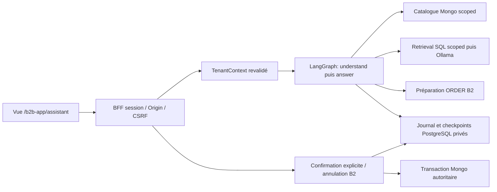

# Assistant B2B V13.8.3 — contrat et limites

Le BFF compose un graphe LangGraph distinct du graphe historique : ses seuls
adaptateurs métier sont le catalogue B1, ORDER B2 et le stockage B4. Les fonctions
pures historiques de critères, résolution littérale et preuve de quantité sont
partagées. Aucun repository global ni second moteur ORDER.



## Activation exclusivement jetable

disabled par défaut ; seulement b2b_business_test avec configuration BFF complète :

- BFF_ASSISTANT_ENABLED=true.
- BFF_ASSISTANT_POSTGRES_URI : cible PostgreSQL stockpilot_ci/stockpilot_test,
  port différent de5432 ; le garde vérifie aussi l'identité du serveur et refuse
  les bases protégées. Ne jamais réutiliser un PostgreSQL de démonstration.
- BFF_ASSISTANT_SCHEMA : stockpilot_b2b ou schéma de test reconnu par B4.
- BFF_ASSISTANT_OLLAMA_URL : origine fixe sans credentials/query/path.
  HTTPS requis ; BFF_ASSISTANT_ALLOW_HTTP=true uniquement pour test local contrôlé.
- Modèles existants : BFF_ASSISTANT_MODEL=qwen2.5:7b,
  BFF_ASSISTANT_EMBEDDING_MODEL=nomic-embed-text. Aucun téléchargement automatique.
- BFF_ASSISTANT_TIMEOUT_SECONDS :60 par défaut, maximum90 par appel fournisseur.

Les migrations PostgreSQL0001 et0002 doivent être appliquées explicitement avant
démarrage, avec le runner et les confirmations de cible décrits dans
[le guide](../postgresql-migrations.md). Aucun DDL au démarrage.
Mongo0001/0002/0003 et PostgreSQL0001 sont inchangées.

## Routes et identité

Préfixe /b2b/api/assistant. Toutes les routes utilisent la session MongoBFF ;
les mutations exigent Origin exact et X-BFF-CSRF. Les headers d'identité forgés
sont refusés. Aucun rôle, organisation ou permission du prompt ne fait autorité.
conversation:own, catalogue:read, stock:read et rag:read sont revalidés pour le
service ; ORDER vérifie en plus ses permissions, le créateur et l'association acheteur.

| Méthode / suffixe | Contrat |
|---|---|
| GET /conversations | Liste privée, limit1–50, offset0–10000 |
| POST /conversations | thread_id externe, identité interne générée côté serveur |
| GET /conversations/{id} | Historique privé, limit1–20, offset0–100 |
| POST /conversations/{id}/messages | message_id stable, message1–4000 caractères, customer_id candidat optionnel vérifié par B2 |
| POST /conversations/{id}/resume | Réconcilier le journal existant puis relire, aucune nouvelle clé |
| POST /conversations/{id}/turns/{turn_id}/retry | Action utilisateur explicite : même demande persistée et même clé |
| POST /conversations/{id}/confirm | order_id, operation_id, preparation_digest, confirmed strictement true |
| POST /conversations/{id}/cancel | order_id, operation_id, confirmed strictement true |
| POST /conversations/{id}/close | Clôture privée réversible seulement par intervention ultérieure ; refuse un tour pending |

Pas de streaming, proxy historique, ingestion publique ou exposition de prompts.
401/403/404/409/422/429/503 gardent le sens du contrat BFF.
Une ressource étrangère et une ressource absente restent indistinguables.

Les réponses sont une liste bornée de tours : message, statut, réponse,
cartes vérifiées et horodatées, snapshot de commande et référence d'opération.
Les prix persistés entiers deviennent des chaînes d'unités mineures au transport.
La classification, les plans privés, les preuves de session et les prompts
ne sont jamais sérialisés dans la réponse. Vue n'utilise pas v-html.

## Réconciliation entre stores

Avant tout appel Mongo de préparation/confirmation/annulation, PostgreSQL commit
un tour et un plan immuables (empreinte canonique, acteur, organisation, opération,
payload et session d'origine). Une seule opération pending par conversation ;
maximum100 tours. Verrou advisory privé B4 pendant l'exécution, sans transaction
distribuée naïve.

MongoDB reste l'autorité de réservation. Si son commit réussit puis l'écriture
du checkpoint échoue, le tour reste pending. La reprise consulte orders.result
avec la clé d'origine et projette le résultat sans rejouer le graphe.
Un404 ne prouve pas un abort : aucun nouveau tour ni clé de compensation.
Un retry explicitement choisi peut rejouer exactement le plan B2 persistant,
avec revalidation et idempotence. Aucun retry automatique du navigateur.
Les conflits métier définitifs produisent un refus durable ; les pannes restent
des erreurs techniques et ne sont jamais transformées en succès.

Un texte « oui » n'appelle jamais confirm. La préparation appartient à la session
d'origine ; une nouvelle session peut lire/réconcilier, mais doit préparer à
nouveau pour obtenir une nouvelle preuve de confirmation valide.
Les anciennes cartes restent des observations datées, pas le stock courant.
La commande est revalidée à la lecture ; une association acheteur révoquée masque
son ancien snapshot. La propriété privée et les permissions de lecture sont
également revalidées avant l'historique.

## Bornes et limites

- Admission assistant : une génération par worker ; admission HTTP BFF existante.
  Aucun quota distribué ni SLA revendiqué.
- Sortie Ollama512 tokens, entrée fournisseur24Kio ; message4000 caractères.
  Maximum5 cartes,20 tours par page,100 tours par conversation.
- Requête HTTP simple ; délai Vue90s pour génération, arrêt de l'attente navigateur
  ne signifie jamais annulation d'un commit.
- Recherche exacte SQL dans l'organisation avant distance vectorielle, puis LLM.
  Injection textuelle n'accorde aucun accès ; elle reste une menace de qualité
  de réponse à évaluer. Les faits catalogue/cartes et mutations sont déterministes.
- Révocation Mongo/BFF/PG/Keycloak non atomique globalement : revalidation avant
  lecture/génération et retour, fences transactionnelles B2 pour les mutations.
- Perte complète de PostgreSQL empêche le parcours assistant ; les résultats
  Mongo restent réconciliables via le contrat ORDER existant une fois rétabli.
- Sauvegarde/restauration appariée, rétention des transcripts, observabilité,
  quotas distribués et exploitation distante sont des gates V13.8.4.
  Aucun accès Internet n'est autorisé par cette implémentation.

## Reproduction

Après build Vue, modèles déjà présents et instance Ollama locale autorisée,
sur ports57914/57915/57916/57918 libres :

```sh
V1383_OLLAMA_URL=http://<hôte-local-autorisé>:11434 \
 .venv/bin/python scripts/tests/validate_bff_keycloak.py --assistant
```

Le harness crée un projet Docker unique tmpfs, une PKI temporaire, identités et
données synthétiques ; il conserve des rapports privés sans credentials et nettoie
uniquement ses ressources identifiées. Il ne lance, n'arrête ni ne migre une démo.
L'option assistant ajoute la campagne V13.8.3 à la campagne navigateur V13.8.2.
Voir [les preuves et limites](../validation/v13.8.3-unified-b2b-assistant.md).
