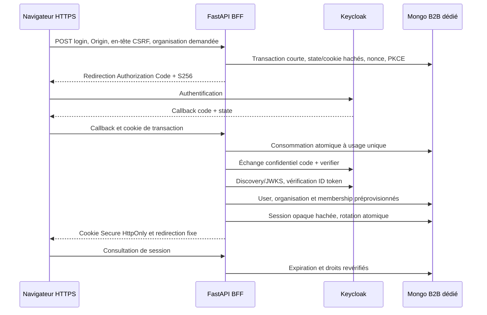

# V13.7.2 — OIDC Keycloak et sessions BFF de test

État historique V13.7.2 : le mode auth_test ci-dessous reste inchangé.
V13.8.1 ajoute un [mode métier de test distinct](b2b-http-api.md), avec contrat
login JSON, admission bornée et routes B1/B2/B3 ; aucune ouverture Internet.

## Frontière et limites

Entrypoint séparé : `uvicorn stockpilot.bff:create_app --factory`, avec TLS.
Le mode `BFF_MODE=disabled` est la valeur par défaut. Le seul mode actif est
`b2b_auth_test` : **aucune aptitude à une exposition Internet n'est attestée**.
Cette application ne charge pas `stockpilot.main`, le graphe, les repositories
métier ou leurs paramètres historiques. Aucun middleware historique n'est remplacé.



Les claims OIDC deviennent une clé exacte `(issuer, subject)` après validation
par l'adaptateur. Les rôles Keycloak ne deviennent pas des permissions métier.
Le resolver V13.7.1 reste l'autorité pour User/Organization/Membership/Principal.
Aucun utilisateur, membership ou organisation n'est créé par le callback.
`customer_id` reste indépendant. Les bases métier ne sont ni migrées ni filtrées
par organisation dans cette phase : elles restent **inaccessibles depuis ce BFF**.

## Routes et erreurs

| Route | Contrat |
|---|---|
| GET /health | Vie du processus, pas readiness OIDC/Mongo |
| POST /b2b/auth/login | JSON avec seulement organization_id ; Origin exact et X-BFF-CSRF: login |
| GET /b2b/auth/callback | state + code/error, cookie navigateur lié à la transaction |
| GET /b2b/auth/session et /me | Identité applicative, rôle/permissions calculés, CSRF et expiration |
| POST /b2b/auth/logout | Origin exact et X-BFF-CSRF lié à la session ; révocation locale |
| GET /b2b/auth/logged-out | Retour de déconnexion fixe |

401 : session/transaction/identité protocolaire absente ou invalide.
403 : identité authentifiée sans accès applicatif actif, ou protection CSRF refusée.
503 : configuration, fournisseur ou stockage indispensable indisponible.
Les réponses publiques ne contiennent ni détails fournisseur ni credentials.
Les routes catalogue/stock/ORDER/import/RAG/chat ne sont pas composées : 404.
Le bearer historique n'ouvre aucune session BFF. `production_saas` reste fermé
dans l'application historique ; `require_customer_identity()` n'est pas remplacé.

## Sessions et protection navigateur

Cookies `__Host-stockpilot_bff` et `__Host-stockpilot_oidc` :
Secure, HttpOnly, SameSite=Lax, Path=/, aucun Domain.
Lax permet le callback OIDC en navigation GET de premier niveau.
Le navigateur ne reçoit aucun access token, refresh token ou ID token.
Les réponses sont no-store ; Referrer-Policy=no-referrer ; pas de CORS permissif.
L'hôte et le schéma HTTPS doivent correspondre à l'origine configurée.
Le callback ne permet aucune URL de retour choisie par le navigateur.

State et cookie de transaction sont aléatoires et hachés en base ; la consommation
atomique précède l'échange du code. Le nonce et le verifier PKCE restent côté serveur.
Le login exige Origin et un en-tête non simple, empêchant une soumission cross-site.
Le logout exige en plus le secret CSRF de session ; aucune mutation métier n'existe ici.
L'identifiant de session aléatoire est stocké seulement sous SHA-256.
La rotation invalide l'ancienne session dans la même transaction MongoDB.
Les instances partagent les sessions ; aucun fallback mémoire runtime.

Par défaut : transaction 300 s, session absolue 1 800 s, inactivité 600 s.
La session expire **au plus tard à l'expiration de l'ID token validé**.
L'accès applicatif est relu à chaque requête : désactivation/suspension refuse
l'accès et révoque la session. Les TTL Mongo facilitent le ménage ; les requêtes
contrôlent elles-mêmes les dates sans attendre le passage du moniteur TTL.

Les tokens du fournisseur sont validés puis abandonnés : **aucun refresh**.
Pas de chiffrement de refresh tokens à concevoir tant qu'ils ne sont pas conservés.
Le logout local révoque avant toute communication fournisseur. Il renvoie une URL
native de logout avec client_id et retour fixe, sans id_token_hint.
La fermeture SSO peut demander une confirmation Keycloak ; elle n'est pas garantie
par la seule révocation locale. Désactivation Keycloak et back-channel logout
ne révoquent pas immédiatement une session applicative existante.
Ces limites, l'absence de quotas d'admission persistants et d'UX complète interdisent
de présenter ce mode comme prêt pour Internet.

## Configuration explicite

Aucun fichier .env privé n'est chargé automatiquement par BffSettings.

| Paramètre BFF_ | Usage |
|---|---|
| MODE | disabled ou b2b_auth_test |
| ORIGIN | Origine HTTPS exacte, sans chemin ni wildcard |
| ISSUER | Issuer exact du realm ; HTTPS distant obligatoire |
| CLIENT_ID / CLIENT_SECRET | Client confidentiel ; secret fourni hors dépôt |
| MONGO_URI | URI d'un stockage dédié, pas une base DEMO |
| MONGO_DATABASE | Nom stockpilot_b2b_ suivi d'un suffixe alphanumérique/underscore |
| CONFIGURATION_KEY | Secret indépendant, au moins 32 caractères |
| ALLOW_LOOPBACK_HTTP_ISSUER | Faux par défaut ; exception uniquement pour le realm jetable loopback |
| TRANSACTION_SECONDS | 30–300, défaut 300 |
| SESSION_ABSOLUTE_SECONDS | 30–3600, défaut 1800 |
| SESSION_IDLE_SECONDS | 10–1800, au plus la durée absolue, défaut 600 |

Un HMAC de configuration invalide les transactions/sessions après changement des
paramètres de confiance ou de la clé ; tous les workers doivent partager ces valeurs.
MongoDB doit supporter les transactions (replica set), les écritures majoritaires
et des dates UTC. L'initialisation explicite du BFF crée seulement ses collections
et index dédiés : identités externes/IDs uniques, membership actif unique,
sessions et transactions à durée limitée. Aucun démarrage de l'application
historique n'effectue cette initialisation. Le préfixe de base évite une confusion
de nom ; il ne remplace pas des credentials Mongo et des ACL dédiés.

## Keycloak jetable et campagne réelle

Version explicitement fixée : **26.8.1**, publication de sécurité du 13 octobre 2026
([source officielle](https://www.keycloak.org/2026/10/keycloak-2681-released)).
Le realm `stockpilot-dev` et le client confidentiel `stockpilot-bff` sont réservés
au test local. Standard Flow actif, PKCE S256 obligatoire, implicit/direct grants
et service accounts désactivés ; URI de callback/logout exactes, aucune wildcard.
Les mots de passe synthétiques et le secret client sont générés à chaque campagne.
Aucun administrateur bootstrap n'est configuré. Les variables du JSON sont
résolues par [l'import natif Keycloak](https://www.keycloak.org/server/importExport).
`start-dev`, HTTP du fournisseur et sslRequired=none sont **strictement locaux**,
pas un modèle de configuration de production.

Exécution depuis un worktree isolé, dépendances Python installées :

```sh
PYTHONDONTWRITEBYTECODE=1 .venv/bin/python scripts/tests/validate_bff_keycloak.py --regressions
```

Le script réserve 57914 (BFF HTTPS), 57915 (Keycloak), 57916 (Mongo répliqué),
57918 (PostgreSQL des tests). Il crée un projet Compose unique, données tmpfs,
réseau propre, secret aléatoire et certificat de test éphémère vérifié côté client.
Il contrôle labels, provenance Compose et montages avant de retirer uniquement
ses propres ressources. Aucun volume préexistant n'est réutilisé ou supprimé.
Le provisioning explicite concerne uniquement une entreprise et un utilisateur
synthétiques dans la base temporaire ; le deuxième utilisateur n'est pas provisionné.
Le rapport sans credentials et les diagnostics privés restent sous tmp/v1372-*,
ignorés par Git. Ne pas publier les logs privés. L'absence de succès/cleanup/intégrité
fait échouer la campagne ; une ressource d'identité incertaine est conservée.

La campagne utilise un client HTTP qui suit le formulaire réel Keycloak et les
redirections, sans moteur navigateur. Elle ne prouve pas une UX Vue ni la politique
de cookies de tous les navigateurs. Les tests unitaires contrôlent les attributs
des cookies et les scénarios adversariaux ; une recette navigateur complète reste
nécessaire avant toute ouverture distante.
Le harnais transmet explicitement les seuls cookies Keycloak du chemin du realm
au formulaire loopback vérifié : HTTPX ne les renvoie pas lorsqu'ils sont Secure
sur HTTP local. Les cookies BFF restent HTTPS et ne sont jamais transmis à Keycloak.
Les connexions HTTP du harnais sont fermées entre requêtes pour permettre l'arrêt
normal du seul BFF jetable pendant le test de persistance.

Validation locale : [rapport V13.7.2](../validation/v13.7.2-keycloak-bff.md).

## Suite et rollback

V13.7.3 : définir le lien user/customer sans réattribuer l'historique ; autorisations
jusqu'aux repositories/transactions et isolation des ressources, tests interorg.
V13.7.4 : UX Vue et navigateur, sélection d'organisation autorisée, expiration et
logout. Avant Internet : TLS/proxy de confiance, ACL/secrets dédiés, quotas,
MFA/recours administrateur, audit, sauvegarde/restauration, révocation fournisseur
et revue de sécurité sur une installation distincte.
Le rollback consiste à ne pas lancer cet entrypoint et à remettre BFF_MODE=disabled.
Aucune donnée métier n'a besoin de migration inverse ; les démos ne sont pas déployées.
