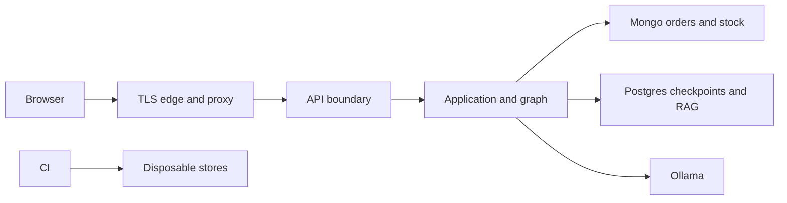

# StockPilot AI threat model

## Executive summary

Baseline `6f0949676e33a21c640b2ccc2f5877368a4dd0cb` is a single-catalogue local application. Signed customer ownership and atomic ORDER protections exist; organizational tenancy and production identity lifecycle do not. Public LLM/catalogue routes, unbounded messages and process-local sessions are unsuitable for SaaS exposure. V13.2 closes SaaS access until those boundaries can be implemented. No compromise or public exposure of v017 was demonstrated.

## Scope and assumptions

Runtime: Vue, FastAPI, LangGraph, Ollama, MongoDB, PostgreSQL/pgvector and tracked Docker/Nginx entrypoints. Existing releases, dev/V11 and v017 are excluded from mutation. CI uses disposable targets with V13.1 guards. Assume a future Internet-facing B2B service with sensitive stock/orders and potentially hostile authenticated buyers. Host operators, repository writers and DB administrators are trusted; their compromise requires a separate model.

The user specified isolation and an untouched local demo. OIDC provider, verified organization membership, commercial roles and final hosting remain undecided. An asynchronous context question was sent; no answer was available during independent work. Recommendations requiring those decisions remain conditional. No invented tenant, account or production token issuer is used.

## System model

### Primary components

`main.py` composes global repositories, use cases and one graph. `auth.py` validates customer JWTs and a separate global technical bearer. `admin_auth.py` protects local operator cookies/CSRF. `MongoOrderTransaction` enforces exact product identity, ownership, idempotent operations and atomic stock reservation. `AsyncPostgresSaver` persists the graph; pgvector uses a separate synchronous adapter.

### Data flows and trust boundaries

- Browser → proxy → FastAPI: JWTs, cookies, text and CSV; future TLS edge is undecided. Origin/CSRF, typed validation, identity and authorization are separate controls.
- API → graph: verified customer plus untrusted text/thread. `assistant.py:customer_thread_key` namespaces checkpoints by signed customer. LLM extraction cannot replace confirmation proof.
- Application → Mongo: synchronous calls, transactional exact stock reservation, customer-scoped order reads/cancel; global catalogue/import/movement access. Tenant context is absent.
- Graph → PostgreSQL: asynchronous durable checkpoints. Graph → pgvector: synchronous global knowledge search. Both stores must be scoped before SaaS activation.
- Application → Ollama: operator-configured HTTP, controlled prompts containing untrusted input. Models have no authority to bypass business guards. Capacity controls must precede work; no automatic confirmation retries.
- CI → dedicated test stores/artifacts: explicit verified targets (`tests/integration_targets.py`) and mandatory jobs. Build/CI is separate from runtime. No merge/release/deployment is authorized.

#### Diagram

## Assets and security objectives

| Asset | Why it matters | Objective |
|---|---|---|
| Orders, stock, reserved identity | unauthorized mutation and double reservation | confidentiality/integrity |
| Conversation and confirmation proof | private context and authority for mutations | confidentiality/integrity |
| Catalogue/import/movements/RAG | organization data must not cross tenants | confidentiality/integrity |
| Credentials and admin sessions | privileges and durable revocation | confidentiality/integrity |
| Ollama and event loop | service capacity for legitimate users | availability |
| Paired order/checkpoint backups | coherent recovery of business state | integrity/availability |

## Attacker model

### Capabilities

Anonymous callers send arbitrary methods, bodies, identifiers, Origins and headers to an exposed endpoint. An authenticated buyer can know foreign order/thread/SKU IDs, submit prompt injection, concurrent replays and stolen/expired credentials. Signing valid claims requires the signing key.

### Non-capabilities

No assumed host shell, DB access, configured URL control, repository write, TLS edge control or secrets. A foreign page cannot read HttpOnly cookies or same-origin CSRF responses. Knowing an identifier never grants authorization.

## Entry points and attack surfaces

The complete [access matrix](access-matrix.md) covers all 29 business operations and generated docs, with methods, authentication, authorization, identity, data, frontend calls, existing tests and expected production behavior. Confirm/conversation/RAG operations are internal to `/assistant`; there is no separate HTTP endpoint for them. Health returns fixed liveness only.

## Top abuse paths

1. Anonymous → public chat/classify → repeated long inference → capacity exhaustion. Public/unbounded baseline paths proven; saturation impact unmeasured.
2. Valid buyer → global catalogue/RAG in a hypothetical shared SaaS → organization B data. Missing tenant model proven; deployed tenant breach not demonstrated.
3. Buyer B learns A's order/thread → read/cancel/confirm replay → attempted stock mutation. Existing owner/thread/proof/transaction checks reject it.
4. Customer or forged tenant header → global admin APIs → attempted privilege escalation. Existing bearer/cookie controls separate admin access; future tenant admin must not inherit global operator scope.
5. Stolen/expired cookie → replay after logout/on another worker → session confusion. TTL/CSRF/cookie controls exist; baseline state is process-local.
6. Foreign origin → cookie admin mutation/login fixation → CSRF. Exact Origin, non-simple login header, bound CSRF and rotation already defend this path.
7. Concurrent confirmations or context bifurcation → replay pending operation → double reservation/stale approval. Existing idempotence, persisted disarming and Mongo atomicity must survive every security change.
8. Huge body/ID, slow upstream or unsafe error → memory/loop exhaustion or leakage. Bound before dispatch, sanitize errors, and require distributed quotas/retention before SaaS.

## Threat model table

| ID | Source / prerequisite | Action and impact | Assets | Existing controls / evidence | Gaps / mitigation | Detection | Likelihood | Impact | Priority |
|---|---|---|---|---|---|---|---|---|---|
| TM-001 | Anonymous, published baseline | repeated expensive inference | capacity | network timeout, `OllamaAdapter` | authenticate direct APIs; bytes/admission limits; distributed quotas before SaaS | 401/413/429, upstream latency | high if exposed | high | high |
| TM-002 | Buyer, hypothetical shared SaaS | global reads/writes across organizations | all tenant data | order owner filters, `customer_thread_key` | close SaaS; scope every repository/transaction/checkpoint/RAG and migrate explicitly | tenant authorization/audit | high if shared | high | critical |
| TM-003 | Buyer knows foreign IDs | confirm/cancel/replay foreign preparation | orders/stock/proof | exact owner/payload checks and scoped cancellation | no bypass shown; extend guards to tenant | owner/replay conflicts | low with controls | high | medium |
| TM-004 | Stolen technical bearer | global administrative mutations | business state | separate bearer/cookie controls, `auth.py` | no token lifecycle/tenant; disable SaaS technical bearer and require managed permissions | privileged credential use | medium | high | high |
| TM-005 | Stolen cookie, multiple workers | inconsistent session reuse/logout | admin access | expiry/rotation/flags/CSRF, `admin_auth.py` | shared hashed-token store and permanent logout; immutable fleet config contract | revoked/expired denials | medium | high | high |
| TM-006 | Foreign website | cookie CSRF/login fixation | admin integrity | exact Origin, bound random CSRF, rotation | preserve existing controls in persistence changes | CSRF denials, no secrets | low | high | medium |
| TM-007 | Authenticated concurrent replay/prompt injection | double reserve/stale authorization | stock/checkpoints | explicit proof, persisted disarm, operation idempotence, Mongo transaction | retain ORDER; include tenant in future proof/replay; no unsafe transaction timeout | conflicts/reconciliation | low with controls | high | medium |
| TM-008 | Huge input or slow upstream | parse/prompt/checkpoint growth and error leakage | capacity/secrets | CSV streaming limits, redacted logs, safe 500 | body/message/ID bounds, safe validation/upstream errors; turn/response budgets remain | bounded route/status metrics | high if exposed | medium | high |
| TM-009 | Malicious Host/Origin/forwarding headers | spoof transport/origin assumptions | sessions/API | exact admin Origin/HTTPS checks | explicit hosts; no raw forwarded trust; edge TLS/HSTS, SPA CSP, API no-store | boundary denials/config checks | medium | medium | medium |

## Criticality calibration

Critical: repeatable foreign-organization stock mutation or checkpoint confirmation under future shared SaaS. High: global credential misuse, anonymous expensive inference or inconsistent durable session revocation. Medium: attacks already constrained by ORDER/CSRF controls, or measured synchronous read delays. Low: low-sensitivity route reconnaissance and fixed liveness; neither alone leaks business data.

## Focus paths for security review

| Path | Reason | Threats |
|---|---|---|
| `presentation/api/auth.py`, `saas_boundary.py` | verified identity and fail-closed environment | 1–4 |
| `presentation/api/admin_auth.py` | cookie, CSRF, revocation, privileges | 4–6 |
| `presentation/api/routes/assistant.py` | thread namespace and context | 2,3,7,8 |
| `application/workflows/nodes.py` | persisted proof/disarming | 3,7 |
| `infrastructure/persistence/mongodb/order_transaction.py`, `order_repository.py` | atomic identity, replay and owner predicates | 2,3,7 |
| `infrastructure/persistence/mongodb/product_repository.py`, `product_import.py` | future tenant boundary | 2,4 |
| `infrastructure/persistence/postgres` | checkpoints, knowledge scope, sync I/O | 2,7,8 |
| `infrastructure/llm/ollama_adapter.py` | upstream failures and capacity | 1,8 |
| `frontend/src/api`, `docker/web.conf.template`, `Dockerfile` | credential transport and proxy policy | 5,6,9 |
| `tests/integration_targets.py`, `.github/workflows/ci.yml` | dedicated data safety and validation | all |

## Notes on use

All discovered entrypoints and runtime boundaries are covered here or in the matrix. CI/dev are separated from production. User context, open questions and conditional claims are explicit. Revise this model when OIDC, tenancy and the real TLS edge exist. It does not certify production readiness. No historical migration or v017 operation was performed.
