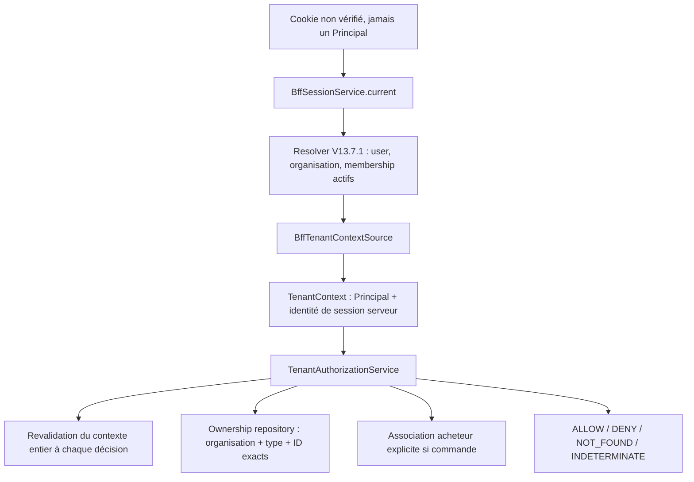

# ADR V13.7.3-A — Frontière d'autorisation et ownership B2B

Décision limitée à cette phase, 20 octobre 2026. Base distante vérifiée :
`80da436e455c48afc5db15c8feaad950960e604f`, fusion réelle de la PR #45 ;
son HEAD de branche `26c68f9` est distinct. Pas de migration ou activation SaaS.
Voir [identité V13.7.1](b2b-identity-foundations.md) et [BFF V13.7.2](keycloak-bff.md).

## Décision et responsabilités

TenantContext est immuable et enveloppe Principal sans recopier ses champs.
L'identité du contexte est l'empreinte de la session validée ; ce n'est pas un
bearer et elle n'est pas exposée par une nouvelle route. BffTenantRequest ne
contient qu'un cookie **non vérifié** ; le pont appelle current() avant de construire
le contexte. current() contrôle expiration/révocation puis réutilise le resolver
V13.7.1 et les stores d'identité. Aucun rôle ou organisation du navigateur ne
remplace ces contrôles. Aucun cache de Principal n'est ajouté.

Le modèle de contexte est une donnée, pas une preuve en soi. Chaque decide()
résout à nouveau le contexte par le port serveur, compare la session et le
Principal entier, vérifie la permission, le couple opération/type et l'ownership
chargé par un port scoped. Un changement de rôle, membership, organisation ou
session invalide l'ancien contexte. Les permissions réutilisent la matrice
V13.7.1 ; aucun rôle global ou PLATFORM_ADMIN n'est ajouté.
Le port serveur est une frontière de confiance : une future implémentation
qui retournerait un ancien snapshot sans revalidation violerait son contrat.

Les types OrganizationResource, OrderResource, ConversationResource et
OperationResource empêchent d'assimiler une commande ou un checkpoint à une
simple ressource d'organisation. Type/ID exacts, organisation et revision sont
obligatoires. Un ownership sans organisation n'est pas un objet tenant valide :
le futur adapter le masque comme absent. Un OrderResource sans propriétaire
humain ou sans acheteur est représentable mais jamais autorisé.

## Décisions et frontières HTTP futures

| Décision | Signification | Traduction future |
|---|---|---|
| ALLOW | Préflight autorisé sur les données actuellement lues | Seulement une condition préalable ; aucune mutation déclenchée |
| DENY | Contexte invalide/obsolète, permission absente, opération/type non admis | 403 après authentification ; absence d'identité reste 401 à la frontière BFF |
| NOT_FOUND | Absence, organisation étrangère, propriétaire étranger pour *_own, ou association acheteur manquante/inactive | Même 404 générique, sans détails permettant de distinguer ces cas |
| INDETERMINATE | Panne, configuration incomplète, ownership dupliqué ou contrat de stockage incohérent | 503 générique, aucune autorisation de secours |

Ne jamais écrire `if decision:` : la conversion booléenne lève TypeError.
Seul `decision is AuthorizationDecision.ALLOW` peut admettre un préflight.
Les erreurs techniques typées sont distinctes des refus ; les erreurs de
programmation inattendues ne sont pas masquées par une exception générique.

Aucun endpoint, proxy, middleware ou changement de sécurité historique n'est
introduit. Le pont BFF n'est composé dans aucune route. Les interfaces historiques
ne reçoivent pas de TenantContext facultatif et gardent leur comportement.
Aucun repository réel d'ownership/association n'est livré : absence de stockage
configuré = INDETERMINATE, jamais retour à un accès global.

## Opérations effectivement définies

Catalogue read, stock read/adjust, commandes read/cancel own ou organization,
exécution d'import et gestion des memberships d'organisation sont associés à
leurs permissions V13.7.1 et à un type exact. Une permission catalogue ne vaut
pas permission RAG, ni permission sur un checkpoint.

ORDER_CREATE, RAG_READ, CONVERSATION_READ, CHECKPOINT_READ et IDEMPOTENCY_REPLAY
sont **réservées et toujours refusées**, même pour ORGANIZATION_ADMIN.
Les contrats de données sont prêts à être testés, pas leurs chemins métier.
Le choix des permissions et les adapters atomiques manquent encore. Ceci
n'affecte pas la création ORDER historique, qui n'appelle pas cette politique.

## Mapping humain / organisation / acheteur

BuyerAssociation relie explicitement association_id, organization_id, user_id,
customer_id, statut actif/désactivé et revision. Aucun email ou égalité de chaînes
ne crée un lien. Une organisation et un humain peuvent avoir plusieurs acheteurs ;
un même humain peut avoir plusieurs organisations. Chaque contexte sélectionne
exactement une organisation validée par sa session.

Pour une commande : organisation de la ligne = organisation active, propriétaire
humain et customer_id persistés, association exacte active et unique.
Pour *_own, owner_user_id doit aussi égaler l'utilisateur courant.
Pour une action organisationnelle, l'association est chargée depuis le
**propriétaire enregistré**, pas depuis l'utilisateur administrateur appelant.
La permission organisationnelle permet d'agir sur une autre commande de cette
organisation, jamais sur une commande étrangère.

Contrat de future persistance : association_id unique ; un enregistrement courant
unique par (organization_id, user_id, customer_id), statut mis à jour et revision
changée lors de révocation ; historique d'audit séparé. Toute pluralité retournée
est ambiguë et bloque. Aucun adapter ou index n'est créé par cette phase.

Ce contrat prudent refuse aussi une commande si son association est désactivée,
y compris une lecture organisationnelle. À arbitrer avant B : distinguer propriété
durable de l'acheteur et droit d'utilisation individuel si l'entreprise doit garder
un accès après départ d'un employé. Aucune politique plus permissive n'est devinée.

**Le mapping ne donne aucune organisation aux anciennes commandes.**
L'Order historique possède customer_id mais ni organization_id ni owner_user_id.
Il reste dans son stockage et son circuit historiques. Une future attribution
exige preuve de provenance, décision humaine et migration explicite réversible.
Les six identifiants user/org/customer/thread/order/operation restent distincts.

## Matrice des ressources

| Ressource | Ownership actuel | Ownership cible | Filtrage actuel | Filtrage futur | Risque |
|---|---|---|---|---|---|
| Catalogue | Produits globaux, sans organisation | Organisation + produit natif/SKU + revision | Critères et recherche, pas de tenant | Organisation dans chaque lecture/liste et jointure stock | Fuite de prix/SKU, collisions et agrégations globales |
| Stock | Quantité dans produit ; mouvements globaux | Organisation + produit natif ; acteur audité | Identité produit exacte, quantité et transaction ; pas d'organisation | Org + ID natif + garde quantité/version dans la transaction | Réservation/restauration sur produit étranger |
| Commandes | customer_id facultatif, aucun owner humain/org | Org + propriétaire humain + acheteur explicite | Routes client : order/customer ; routes admin et operation_id globaux | Org + ID + owner pour own ; association et version ; aucune lookup globale de secours | BOLA, confusion acheteur/tenant, double débit |
| Imports | Admin local, reçus globaux par operation_id | Organisation + batch ; acteur audité | Session/CSRF, aperçu lié à session, fingerprint | Org dans batch, reçu, SKU, aperçu et transaction CREATE_ONLY | Injection interorg ou rejeu de reçu étranger |
| RAG | knowledge_chunks global, source unique | Organisation + document/source + version de corpus/modèle | Top-K vectoriel sans tenant | Filtre stockage/retrieval avant top-K et avant LLM | Fuite de documents via prompt, cache, citations |
| Conversations | Couple signé customer/raw thread haché | Org + humain + acheteur + thread, identifiant serveur versionné | customer_thread_key, pas d'organisation | Scope obligatoire à chaque lecture/reprise, pas raw thread seul | Confused deputy, confirmations ou historique étrangers |
| Checkpoints | Saver PostgreSQL partagé | Namespace/stockage scoped à la conversation tenant | thread_id dérivé, checkpoint_ns du saver | Toutes tables, blobs et pending writes scoped ; accès et reprise contrôlés | Rejeu d'une confirmation/checkpoint étranger |
| Idempotence | operation_id global dans chaque famille | TenantOperationKey(org, operation_id), action/cible/fingerprint enregistrés | Uniques globaux commandes/imports/mouvements | Clé composite dans lecture, insert, recheck et rapprochement atomiques | Reçu d'un autre tenant, double réservation |
| Administration | Sessions admin historiques, accès global local | Membership exact de l'organisation ; plateforme séparée | Auth admin/CSRF, aucune scope org | Organisation et permission sur chaque cible, aucune fonction plateforme implicite | Élévation de rôle ou administration d'une autre organisation |

## Filtres, index, migrations et tests requis en V13.7.3-B

Tous les index suivants sont **proposés**, pas créés. Aucun schéma métier existant
n'est modifié ; choisir des collections/bases tenant distinctes ou une migration
validée avant d'ajouter des discriminants. Aucune lecture duale globale par défaut.

- **Catalogue** : [product_repository.py](../../src/stockpilot/infrastructure/persistence/mongodb/product_repository.py).
  Nouveau contrat de repository obligatoire pour listes, recherche, SKU et
  pagination/totaux. Unicité (org, sku) et identité native toujours scoppée.
  Tester mêmes SKU/noms dans deux orgs, doublons, compteurs et filtres Advice ;
  garder la sélection déterministe et les prix/stock vérifiés.
- **Stock** : [order_transaction.py](../../src/stockpilot/infrastructure/persistence/mongodb/order_transaction.py),
  [stock_adjustment_transaction.py](../../src/stockpilot/infrastructure/persistence/mongodb/stock_adjustment_transaction.py).
  Gardes org/produit/statut dans réservation, annulation et mouvements de la même
  transaction ; index (org, operation_id), historique (org, produit, date, mouvement).
  Tester concurrence, SKU ambigu, quantité invalide, absence de réservation avant
  confirmation, rollback et issue inconnue. Aucun changement de ces gardes en A.
- **Commandes** : [Order](../../src/stockpilot/domain/entities/order.py),
  [repository](../../src/stockpilot/infrastructure/persistence/mongodb/order_repository.py).
  Index actuels globaux order_id et operation_id, historique customer/date/order.
  Futurs (org, order_id), (org, operation_id), (org, owner_user, date, order_id)
  et (org, customer, date, order_id). Tester read/cancel foreign =404,
  mapping révoqué, événements, propriété et confirmation explicite/idempotente.
- **Imports** : [product_import.py](../../src/stockpilot/infrastructure/persistence/mongodb/product_import.py).
  Batch et fingerprint attachés à l'org et à l'acteur/session ; contrôle des
  produits insérés dans la même transaction ; uniques (org, operation_id), (org, sku).
  Tester aperçu d'une autre org, même operation_id avec payload/cible différents,
  reçus étrangers et reprise après commit incertain.
- **RAG** : [repository pgvector](../../src/stockpilot/infrastructure/persistence/postgres/pgvector_knowledge_repository.py),
  [schéma et corpus](../rag.md). Remplacer l'unicité source globale par une stratégie
  scoped validée ; index (org, source/document) et recherche vectorielle filtrée
  correcte ou stockage séparé. Tester org A/B avec vecteurs identiques, top-K,
  embeddings/ingestion, caches, résultats sans provenance et citations.
  Filtrer seulement la réponse textuelle finale ne protège pas les données.
- **Conversations** : [customer_thread_key et route](../../src/stockpilot/presentation/api/routes/assistant.py).
  Namespace versionné sans collision pour org/humain/acheteur/thread, éventuellement
  ID de conversation serveur + registre scoped unique. Ne pas reprendre les clés
  historiques comme clés tenant. Tester même raw thread dans deux orgs/acheteurs,
  changement d'org, annulation et état préparé non transférable.
- **Checkpoints** : [saver](../../src/stockpilot/infrastructure/persistence/postgres/checkpointer.py).
  Examiner le schéma de la version LangGraph installée avant index/migration ;
  inclure checkpoint_ns/ID, blobs et pending writes dans l'isolation, pas seulement
  la requête principale. Tester reprise/redémarrage, sérialisation, lecture étrangère
  directe, prompts et état mémoire. Pas de transaction Mongo/PG distribuée actuelle.
- **Idempotence** : [index ORDER](../../src/stockpilot/infrastructure/persistence/mongodb/order_repository.py),
  [index mouvements](../../src/stockpilot/infrastructure/persistence/mongodb/stock_movement_indexes.py).
  TenantOperationKey est une paire immuable, pas une concaténation ambiguë.
  Choisir namespace de famille si plusieurs collections, action/cible et empreinte
  immuables ; toutes recherches de rapprochement/retries doivent garder l'org.
  Tester même ID dans deux orgs, concurrence même org, payload/action différents,
  replay après annulation et absence de double débit. Les anciennes clés restent.
- **Administration** : [routes backoffice](../../src/stockpilot/presentation/api/routes/backoffice_products.py),
  [identités dédiées](../../src/stockpilot/infrastructure/persistence/mongodb/b2b_identity.py).
  Utiliser l'unicité membership active (user,org), une revision pour les changements,
  audit et politique d'attribution bornée des rôles. Tester admin A vers membership B,
  autoélévation, retrait de droits, accès direct API et fonctions plateforme.
  Les comptes de récupération et PLATFORM_ADMIN restent un chantier distinct.

## Concurrence, rollback et activation

La revalidation empêche l'utilisation d'un ancien contexte **entre deux décisions**.
Elle ne crée aucune atomicité entre plusieurs lectures ni avec une future écriture.
Une révocation/réattribution peut survenir après un préflight ALLOW : le consommateur
futur doit revalider et conserver organisation, ownership/revision, association et
permission jusque dans sa transaction/son filtre conditionnel. Pour plusieurs
stores, choisir un mécanisme de verrouillage/version/fencing et prouver ses courses.
Ne pas traiter le retour ALLOW comme un ticket sérialisable ou réutilisable.

B1 : choisir implantation du premier pilote, ownership et mapping, puis repositories
catalogue/stock en lecture avec tests réels interorg et compteurs scoped.
B2 : commandes/acheteurs/idempotence et écritures atomiques avec stock, conditions
de révocation/versions, migration explicitement approuvée et preuve de restauration.
B3 : imports/mouvements/admin et audit ; ne pas attribuer PLATFORM_ADMIN implicitement.
B4 : conversations/checkpoints/RAG avec isolation de retrieval, permissions approuvées
et tests de reprise/non-fuite. L'accès métier BFF reste fermé tant que ses gates
ne sont pas toutes démontrées ; aucune étape ne réutilise les données des démos.

Rollback A : ne pas composer ces modules, ou retirer la PR ; aucune donnée/index
métier ou clé de checkpoint/idempotence n'a changé. Les migrations B devront avoir
un inventaire d'attribution, sauvegarde/restauration vérifiée, journal de changements,
retour réversible vers les stores précédents et refus des données sans propriétaire.

Avant Internet : isolation repository/transactions/RAG réellement testée, protocole
BFF navigateur, CSRF/TLS/proxy, quotas/deadline totale OIDC, révocation et exploitation,
sauvegardes et politique de récupération. **StockPilot n'est pas multi-tenant opérationnel.**
Les doubles mémoire de cette phase ne prouvent pas une isolation MongoDB/RAG.

Voir le [rapport de validation](../validation/v13.7.3a-tenant-authorization.md)
pour les campagnes exécutées, la revue et l'intégrité des environnements.

## Complément V13.7.3-B2 — preuve de stockage, sans route activée

L'[ADR commandes](tenant-orders-atomicity.md) remplace les hypothèses B2 pour le
nouveau chemin dédié, sans modifier la politique générique réservée ni l'historique.

| Ressource | Ownership actuel B2B | Ownership cible | Filtrage actuel | Filtrage futur | Risque restant |
|---|---|---|---|---|---|
| Commande | org, customer, created_by explicites | Organisation ; own = créateur | org/order_id jusque transaction, permission/grant actuels | Même contrat dans future API | Session/logout hors transaction ; HTTP non activé |
| Acheteur | Grant org/user/customer actif | Grant explicite et cycle de vie approuvé | Tuple exact unique, fence transactionnelle | Administration et audit scoped | Grant désactivé bloque aussi manager |
| Stock réservé | Produit B1 org/ObjectId/SKU | Même propriété | org/id/SKU/revision/statut/disponibilité atomiques | Mouvements/imports cohérents avec reserved | Contention org ; consommation non livrée |
| Idempotence | Journal org/namespace/operation + acteur/empreinte | Durable sans TTL de double débit | Lookup et index uniques scoppés, même transaction | Contrats équivalents pour futurs workflows | Ne jamais jeter les résultats inconnus ou le journal |

Conversations/checkpoints/RAG restent non isolés par ce chemin et inaccessibles
depuis le BFF. Les futurs filtres de retrieval doivent précéder le LLM.
